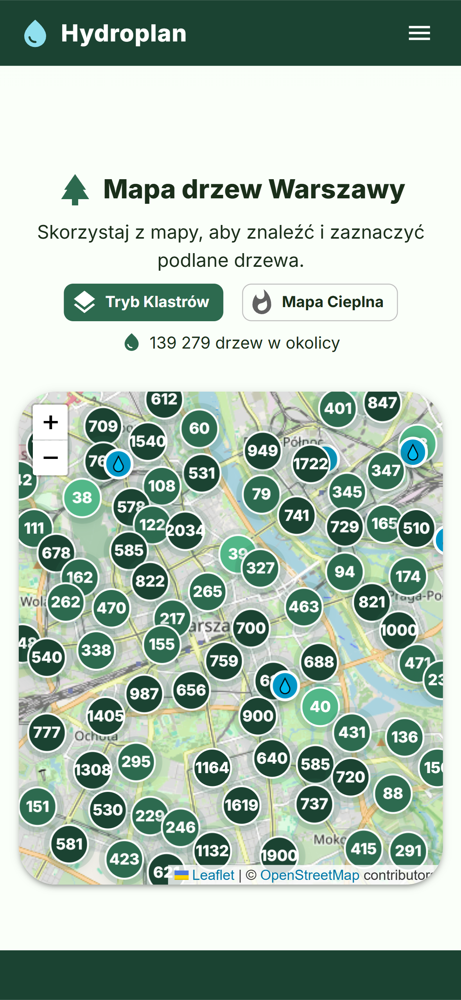
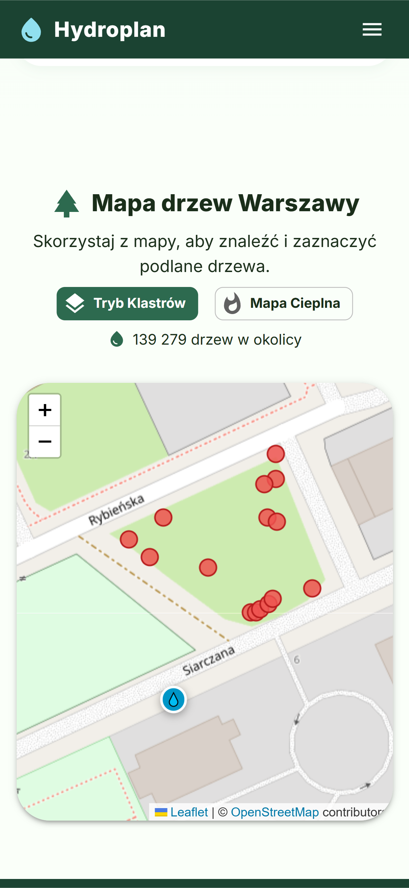
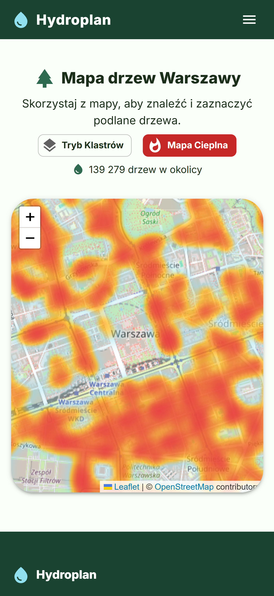
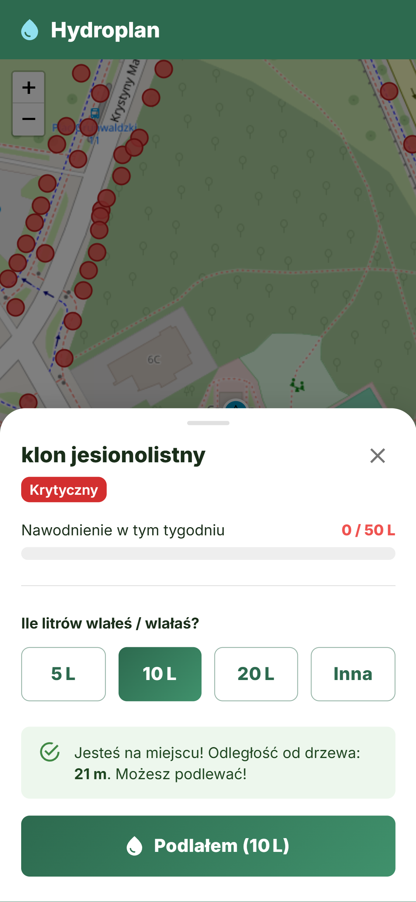
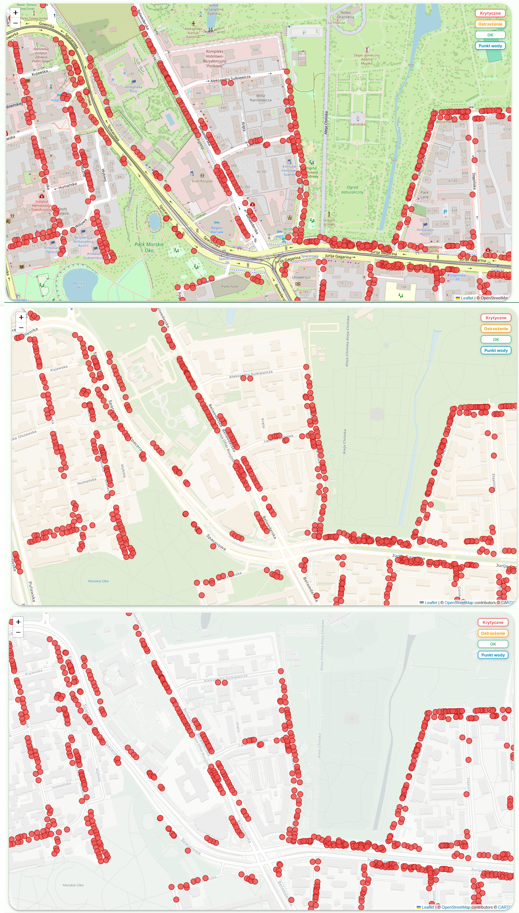

# Hydroplan (case study)

> PL: Hydroplan to aplikacja PWA do podlewania drzew miejskich w Warszawie. Zrobiliśmy ją w czteroosobowym zespole dla Fundacji Alter Eko. Kod jest w prywatnych repozytoriach zespołu, więc tutaj opisuję tylko swoją część: import danych o drzewach z API miasta i mapę.

Live app: https://hydroplan-chi.vercel.app/

## What it is

Hydroplan is a PWA for "Podlej Warszawę", a project where volunteers borrow a watering can at one of 10 partner points and water street trees during drought. The map shows trees around you and colours them by how much water they got this week. A logged-in user can record a watering once they're near the tree.

Four of us built it for Fundacja Alter Eko. The project was financed by the City of Warsaw from its Fundusz Edukacji Ekologicznej. The authors are listed in the footer of the site.

It was the first project I worked on that wasn't just my own. I'm into maps, so from the start I was the one assigned to the map. My part was the tree data import in the backend and the map in the frontend. Accounts, login, the admin panel and the rest of the app are my teammates' work.

## Screenshots

<table>
  <tr>
    <td></td>
    <td></td>
  </tr>
  <tr>
    <td>The whole city with trees grouped into clusters. Blue markers are partner points.</td>
    <td>Zoomed in, every tree is a dot coloured by its status. Red means critical.</td>
  </tr>
  <tr>
    <td></td>
    <td></td>
  </tr>
  <tr>
    <td>Heat map mode. Areas with many dry trees show up red.</td>
    <td>The watering panel with the distance to the tree, here 21 m.</td>
  </tr>
</table>

## Stack

- Frontend: Next.js 16, React 19, TypeScript, MUI, Leaflet with react-leaflet, supercluster, leaflet.heat
- Backend: Java 21, Spring Boot 4, Hibernate, PostgreSQL with PostGIS
- Data: the tree inventory published by the City of Warsaw at `api.um.warszawa.pl`

## Backend: importing the city's tree data

The city publishes its tree inventory through a `datastore_search` endpoint. In June 2026 I wrote `TreeSyncService`, which downloads it and upserts it into our `Trees` table by the city's record ID. In November 2026 the map showed 139,279 trees.

My first version sent one request with `limit=100000` and then did a separate lookup and save for every record. It worked fine on my machine. Once it was on `main`, the server started crashing, because it had very little RAM and the import held the whole list of trees in memory at once. Fixing that became a priority, and most of my backend work came out of it:

- The import now goes in pages of 5000 records. Each page costs one `SELECT ... IN` for the existing rows and one `saveAll`, with Hibernate batching turned on.
- Before downloading anything, the service asks the API for a single record, reads the `total` field and compares it with the local row count. If the table is already complete, it skips the import.
- It runs once after startup and then every day at 02:00. The city's data can change while our server is running, so one import at startup isn't enough, and I didn't want a heavy job running at a time when someone might be using the map.

The bug I remember best came right after the switch to pages: the table had gaps. The requests had no sort order, so the API was free to return rows in a different order each time. Pages overlapped, and some records never arrived. Adding `sort=_id asc` to the request fixed it.

For the map I added two public endpoints. `GET /api/v1/trees` returns a light list of all trees with only id, species, status and coordinates, and `GET /api/v1/trees/{id}` returns the details of one tree when the user taps it. In my version the status was computed in SQL from the waterings of the last 7 days: at least 75% of the weekly need is OK, at least 30% is a warning, anything below is critical. My teammates later changed it to count from Monday and scale the thresholds by the day of the week. They also added caching and a more compact endpoint for the full map, which the frontend uses now. Tree details still come from my endpoint.

On the database side I extended the `Trees` table with the fields the city provides (Latin species name, district, address, height, trunk circumference, crown diameter, health and a few more) and added indexes: GiST on the location, one on the city ID for the import, and one on `(treeId, createdAt)` in the watering events table for the status query. I also turned on gzip for responses and, in late June, fixed a round of crashes caused by database connection settings.

## Frontend: the map

I worked on the frontend from May to October 2026. I started by creating the Next.js project and adding Leaflet and the first PWA manifest.

### Showing every tree in the city

Single markers weren't an option with this many trees. I added clustering with `leaflet.markercluster` and turned spiderfying off, so trees stay at their real coordinates and clusters split into single trees at zoom 18. The team later moved clustering to `supercluster`. After that change the logged-in view stopped grouping trees, and I fixed it by sending both map modes through the same cluster layer.

The heat map isn't mine. A teammate came up with it and implemented it, and I thought it was a nice extra.

In June I made the map faster:

- a memoised component for a single tree marker and canvas rendering for markers
- the heat layer is updated with `setLatLngs` and no longer recreated on every data change
- a 400 ms debounce on requests while the map is moving
- a minimum query radius of 700 m, and no new request if the map moved less than 200 m since the last one

The last one also stopped markers from flickering at high zoom.

Trees planted close together were hard to tap, so I raised `maxZoom` to 21 and let Leaflet upscale the tiles above their native zoom.

### Choosing the base map

I considered moving the map to MapLibre. I liked its default look, it's more modern and easier to customise, and I built a local demo with it. In the end Leaflet with a different tile layer got the job done, so I stayed with it.

I showed the team three tile styles on the same piece of the city: standard OpenStreetMap, CARTO Voyager and a grey CARTO style. We picked Voyager, the one in the middle. It looks clean and modern, and its background colours are light and few, so the tree dots stand out and the map isn't as busy as standard OpenStreetMap.

In October the CARTO tiles started to require an API key. Converting everything to MapLibre at that point made no sense when Leaflet worked, so I removed the CARTO layer and went back to standard OpenStreetMap tiles. The clusters have their own styling anyway (I had changed them from black and yellow to the app's green palette), so the map still looks fine.

### Location and watering

When the browser gives no location, the first version silently loaded trees around the city centre. I changed that twice. First the user could click a point on the map and get trees within 800 m of it. Later the map fell back to the clustered view of the whole city.

Watering is allowed within 100 m of the tree, and the panel shows your distance to it. When I tried the app outside, the distance didn't change as I walked. It felt broken, because other GPS apps update as you move. The panel was reading the position only once, when it opened. I switched it to `watchPosition`, and now the distance follows the user.

I also added a custom amount field next to the 5, 10 and 20 L buttons, limited to 20 L, fixed the bottom navigation bar covering the partner logos on phones (it now respects `safe-area-inset-bottom`), and moved the PWA install prompt into a shared context used by the footer and the profile page.

## What I learned

Most of what I took from this project is about working with other people. Before Hydroplan I used git alone. Here I had to work on branches, merge other people's changes into mine and write commit messages that somebody else could understand. We kept two main branches, `staging` for work in progress and `main` for what was deployed.

We also argued a fair bit, mostly about how a given thing should be implemented and how much freedom each of us has to change things on our own. What I took from those arguments is that you tell the team about every change that affects others, even a small one. A "minor" change in the map or the API can break somebody else's part, and they find out much later.

On the technical side, the small server taught me to think about memory and about when a job runs, which I'd never had to think about on a server before.

## Source code

The code is in the team's private repositories and it stays there, so this repo has no source files.

My part of the data import started as a separate prototype, which is public: [warsaw-tree-api-map](https://github.com/Ketnak22/warsaw-tree-api-map). It fetches the same city dataset and shows it on a map.